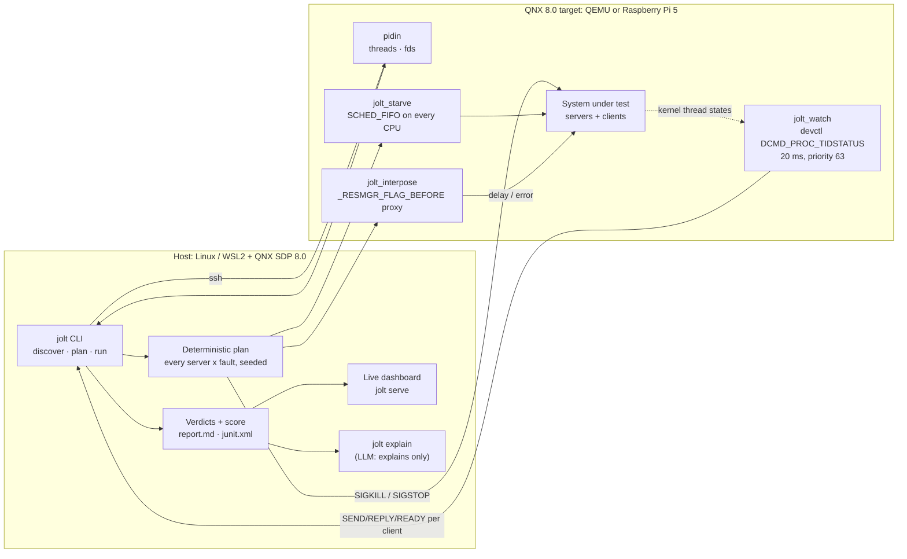

# Jolt: chaos engineering for QNX 8.0

[](https://github.com/mukeshkbj/QNX/actions/workflows/ci.yml) [](LICENSE)

Jolt finds the place where your QNX system freezes before your customer does.

QNX systems are built from small processes that talk by synchronous message passing. When a server **dies**, the kernel unblocks its clients with an error. When a server **hangs** (frozen, starved or deadlocked), nothing does. A client without a timeout waits forever.

Jolt connects to a running QNX 8.0 target and reads its live message-passing graph from `pidin`. It then injects faults against every server: kill, freeze, CPU starvation and slow replies. It watches every client from the kernel's point of view and produces a resilience score, with the exact fix for each failure.

- **Deterministic:** the fault plan is full coverage over the discovered graph, shuffled with a seed. The same graph and seed give the same plan.
- **Evidence for CI:** writes `report.md`, `report.json` and `junit.xml`.
- **Dev and test targets only:** it kills and stops processes. Never point it at production.

> Built for the [QNX Global Hackathon](https://qnx.devpost.com/), Developer Tooling & Host Tools track.

## Architecture



The LLM never picks faults or verdicts. Those come from the plan and the kernel measurements, so the same seed gives the same results.

## Quick start

Requirements: a Linux host (Ubuntu 22.04, or WSL2 on Windows) with QNX SDP 8.0, plus a QNX 8.0 target reachable over SSH (a QEMU VM from `mkqnximage`, or a Raspberry Pi 5). [`setup/SETUP.md`](setup/SETUP.md) has the exact host and VM setup we used, including three SDP/WSL workarounds. After a host restart, `bash setup/vm-ip.sh` finds the VM's new address and updates `ssh qnxvm`.

**New to QNX message passing?** Start with the codelab [Why your QNX client hangs](docs/codelab.md).

Recorded results from our runs are in [`jolt-out/`](jolt-out/): `report.md`, `junit.xml`, and `events.jsonl` for dashboard replay.

```bash
# 1. Build the target programs and copy them to the target
target/build.sh qnxvm                  # or qnxpi for a Raspberry Pi 5

# 2. Start the demo robot stack on the target
ssh qnxvm sh /tmp/jolt/stack.sh start

# 3. Look at the graph, preview the plan, then run it (with the live dashboard open)
python3 -m jolt serve &                  # http://localhost:8765/dashboard.html
python3 -m jolt discover --target qnxvm --only imu,planner,actuator,watchdog
python3 -m jolt plan     --target qnxvm --only imu,planner,actuator,watchdog
python3 -m jolt run      --target qnxvm --only imu,planner,actuator,watchdog --seed 1 \
        --out jolt-out/before --reset "sh /tmp/jolt/stack.sh start"

# 4. Fix the stack (timeouts + supervision) and run again
ssh qnxvm sh /tmp/jolt/stack.sh start-fixed
python3 -m jolt run      --target qnxvm --only imu,planner,actuator,watchdog --seed 1 \
        --out jolt-out/after --reset "sh /tmp/jolt/stack.sh start-fixed"

# 5. Ask an LLM to explain the failures and propose diffs (verdicts stay deterministic)
export ANTHROPIC_API_KEY=...            # optional; without it the prompt is saved to explain-prompt.md
python3 -m jolt explain --run jolt-out/before --src target/demo-stack
```

`--reset` is a command run on the target before every experiment, so each fault starts from the same baseline. The `delay` fault needs it, because clients must reconnect through the interposer.

## Faults

| Fault | How it is injected | What passes |
| --- | --- | --- |
| `kill` | `SIGKILL` the server | Clients get an error, reconnect, and the server is restarted |
| `freeze` | `SIGSTOP` for 5 s, then `SIGCONT` | No client stays blocked for the whole freeze |
| `starve` (one system-wide experiment) | `jolt_starve`: one `SCHED_FIFO` spinning thread per CPU at priority 60 (`ThreadCtl(_NTO_TCTL_RUNMASK)`), started 300 ms after `jolt_watch`, which samples at priority 63 | No client is starved (runnable but not running) or blocked on its server for more than 1 s |
| `delay` | `jolt_interpose`: a proxy registered in front of the server's resource-manager path with `_RESMGR_FLAG_BEFORE`, holding each request 1.5 s | No client waits longer than 1 s per request |
| `error` | `jolt_interpose -e 5`: every request through the path fails with `EIO` | Clients survive and recover once the path works again. Idle if the interposer failed no requests |

Observation uses `jolt_watch`, which reads every client thread's kernel state every 20 ms with `devctl(DCMD_PROC_TIDSTATUS)`. It records SEND/REPLY blocking on the faulted server and READY-but-not-running starvation. Blocking episodes are therefore measured, not guessed from coarse samples.

## Results

All runs are on QEMU x86_64, QNX 8.0, seed 1. Recorded outputs are in [`jolt-out/`](jolt-out/).

**Demo stack.** Each round adds the fix that Jolt's previous run pointed to:

| Run | Score | What Jolt reported |
| --- | --- | --- |
| `start` (before) | 29/100 | Freeze imu or actuator: planner hangs for the whole freeze (4.8 s). Delay 1.5 s: slow-intolerant (1.49 s per read). System-wide starve: planner (priority 10) starved. Kill imu: not restarted. Planner does survive EIO errors |
| + timeouts, heartbeat watchdog, supervision, planner at priority 61 | 64/100\* | Under a priority-60 load, the servers' heartbeat threads and the watchdog are starved, so healthy servers would look hung. Nothing restarts the watchdog |
| + heartbeat threads and watchdog at priority 62 | 82/100\* | Kill watchdog: nothing supervises the supervisor |
| + guard loop for the watchdog (`start-fixed`) | **100/100** | Every exercised check passes. Freezes recover in about 0.8 s, delay costs 0.48 s per request, EIO is survived |

\* Intermediate rounds were scored before starve became a single system-wide experiment and `error` was added, so their scores aren't directly comparable.

**Code we didn't write:**

| Target | Score | Findings |
| --- | --- | --- |
| [QNX `shim-demo`](https://gitlab.com/qnx/projects/shim-demo) (`eventfd-mgr` + `libeventfd` shim, built unchanged), driven by a Linux-style harness client ([`thirdparty/shim-demo/efd_worker.c`](thirdparty/shim-demo/efd_worker.c), ours) | 0/100 | See below |
| QNX system services on the QEMU image (`slogger2`, `random`; freeze + system-wide starve only) | 77–85/100 | Freezes: every client idle; slog2 logging is shared-memory based and `/dev/random` is read rarely, so nobody blocks. Starve at priority 60: `io-sock` (network) and `devb-eide` (disk) are starved in both recorded runs; `random` was starved in one, because it only competes for the CPU when it is runnable during the 4 s load, hence the range. On this image they run below 60. That's a system priority-design fact, not a QNX bug |

`shim-demo` findings:

- **Error (EIO on `/dev/eventfd`): `lost-stdio`.** This is a real bug that Jolt surfaced.
  - When the shim's initial `write()` fails, `eventfd()` returns `EXIT_FAILURE` (1) instead of -1.
  - The client then uses **its own stdout** as the eventfd. Its 8-byte counter appears in its log as `001 \0 \0 …`.
  - On the next error, the client `close()`s it, so fd 1 disappears from `pidin fds`.
- **Delay:** blocked 4.1 s, because write and read are both delayed.
- **Freeze:** hangs for the whole freeze.
- **Starve:** starved at default priority.
- **Kill:** `eventfd-mgr` is not restarted.

Reading the source also shows that all clients share one counter, and that a blocking `read()` never blocks. Those are code-review notes, not Jolt findings. The sample's README calls it a proof of concept.

**idle** means a client sent the faulted server no request during a freeze, delay or error fault. That check wasn't exercised, so it's excluded from the score rather than counted as a pass.

## Three things Jolt teaches about QNX

1. **Client timeouts work against a slow server, but not against a frozen one.** Resource-manager and `name_attach()` channels set `_NTO_CHF_UNBLOCK`. When a client's `TimerTimeout` fires while it is REPLY-blocked, the kernel doesn't release it; it sends the server `_PULSE_CODE_UNBLOCK` and waits for the server to answer.
   - A live but slow server, here `jolt_interpose`, answers with `ETIMEDOUT`, and the client carries on: 0.48 s instead of 1.5 s.
   - A frozen server never answers, so the client hangs despite the timeout. The fix that passes is external hang detection: heartbeat pulses to a watchdog, then `SIGKILL`. The kernel then unblocks every client with an error, and the watchdog restarts the server.
2. **Priority inheritance protects a critical client, not the system around it.** At priority 61, `planner` keeps working under a priority-60 load, because its servers run at its priority while serving it (`pidin` shows `imu`'s receive thread at `61r`). Their own heartbeat threads, the watchdog, and on the QNX image `io-sock` and `devb-eide`, still starve. Supervision has to run above the load too.
3. **`name_attach()` names are exclusive.** `resmgr_attach()` on `/dev/name/...` with `_FTYPE_NAME` fails with `EEXIST`, so such services can't be interposed by path. Ordinary resource-manager paths can: `_RESMGR_FLAG_BEFORE` plus pathname fall-through. The interposer answers its own connect with `ENOENT`, and libc moves on to the real server.

## The demo robot stack

| Process | Role | Deliberate weakness (fixed by `start-fixed`) |
| --- | --- | --- |
| `imu` | Resource manager at `/dev/imu` (`iofunc`); each `read()` returns a fresh sample | Not supervised: nobody restarts it if it dies |
| `actuator` | Serves motor commands | Supervised by `watchdog` |
| `planner` | Every 200 ms: `read()`s `/dev/imu`, then `MsgSend`s to `actuator` | No timeouts, so it hangs if a server is slow or frozen |
| `watchdog` | Restarts servers whose names or paths vanish (it reads procnto's directory listings, so it never blocks on the server). With `-n`, it also kills servers whose heartbeat pulses stop for 1 s | Without heartbeats it can't see a freeze |

The weaknesses are deliberate, so the before/after runs are easy to follow. Jolt is also run against QNX code we didn't write; see `docs/`.

## QNX evidence

| QNX 8.0 feature | Where | What it proves |
| --- | --- | --- |
| Native message passing (`MsgSend`/`MsgReceive`/`MsgReply`, `name_attach`) | `target/demo-stack/node.c` | The system under test is a real QNX message-passing stack |
| Kernel timeouts (`TimerTimeout`, `_NTO_TIMEOUT_SEND/REPLY`) | `node.c` `call()` | The fix Jolt recommends for `hang-no-timeout` |
| Thread states and blocked-on (`pidin %J %B`) | `jolt/discover.py` | The graph comes from the kernel's view of who waits on whom |
| Connections and side channels (`pidin fds`) | `jolt/discover.py` `parse_fds` | Edges exist even when nobody is blocked |
| Priorities, FIFO scheduling, run masks (`ThreadCtl(_NTO_TCTL_RUNMASK)`) | `target/tools/jolt_starve.c` | Starvation is injected on the victim's own CPU |
| Signals `SIGKILL`/`SIGSTOP`/`SIGCONT` | `jolt/runner.py` | Kill and freeze faults |
| Name service `/dev/name/local` (served by procnto) | `target/demo-stack/watchdog.c` | Supervision that never blocks on the server it watches |
| Resource-manager interposition (`_RESMGR_FLAG_BEFORE`, `dispatch_create_channel`, pathname fall-through) | `target/tools/jolt_interpose.c` | Delay and error faults on any resource-manager path, transparently forwarded to the real server |
| `_NTO_CHF_UNBLOCK` / `_PULSE_CODE_UNBLOCK` | `jolt_interpose.c` | A slow server releases timed-out clients; shows why frozen servers can't |
| Message forwarding (`MsgRead`, `srcmsglen`/`dstmsglen`, combined connects) | `jolt_interpose.c`, checked by `target/tests/interpose_check.c` | Requests of any size and replies such as `fstat()` pass through the interposer unchanged |
| Kernel thread state via procfs (`devctl(DCMD_PROC_TIDSTATUS)`) | `target/tools/jolt_watch.c` | 20 ms-resolution blocking measurements |
| Resource manager (`iofunc`, `resmgr_attach`, `dispatch`) | `target/demo-stack/node.c` (`imu`) | Realistic `/dev` sensor in the demo stack |
| Pulses (`MsgSendPulse`) and receive timeouts | `node.c` heartbeat, `watchdog.c` | Hang detection that can't block the watchdog |

Build details: QNX SDP 8.0. Targets: x86_64 (QEMU, `gcc_ntox86_64`) and aarch64le (Raspberry Pi 5, `gcc_ntoaarch64le`). Compiler: `qcc`.

## Licence

Apache-2.0
